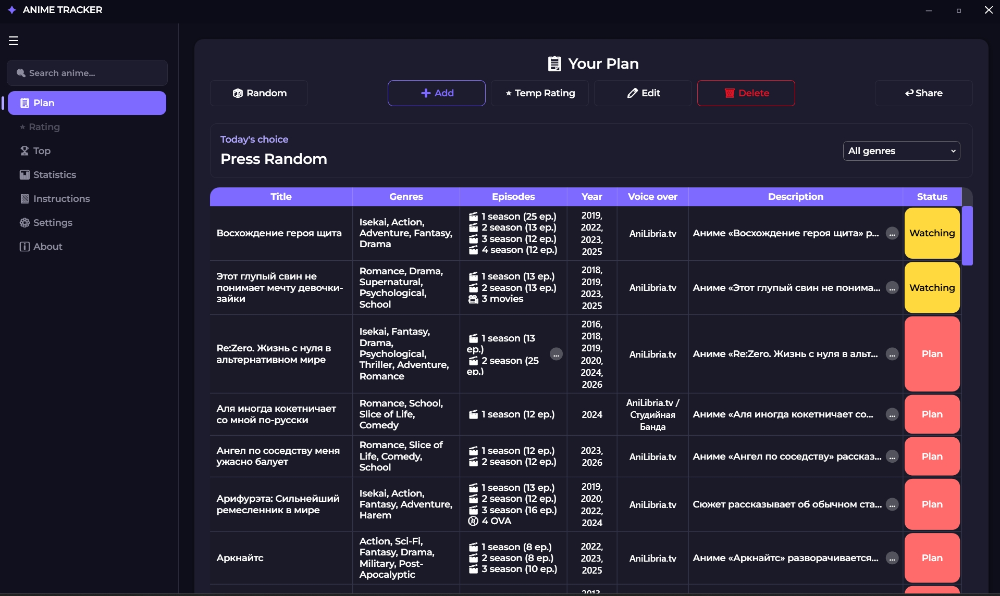
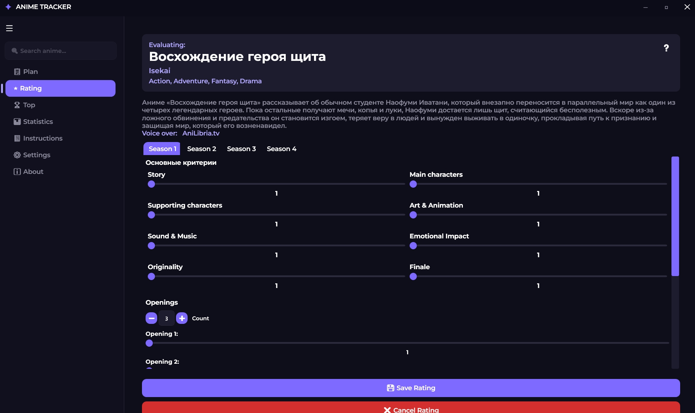
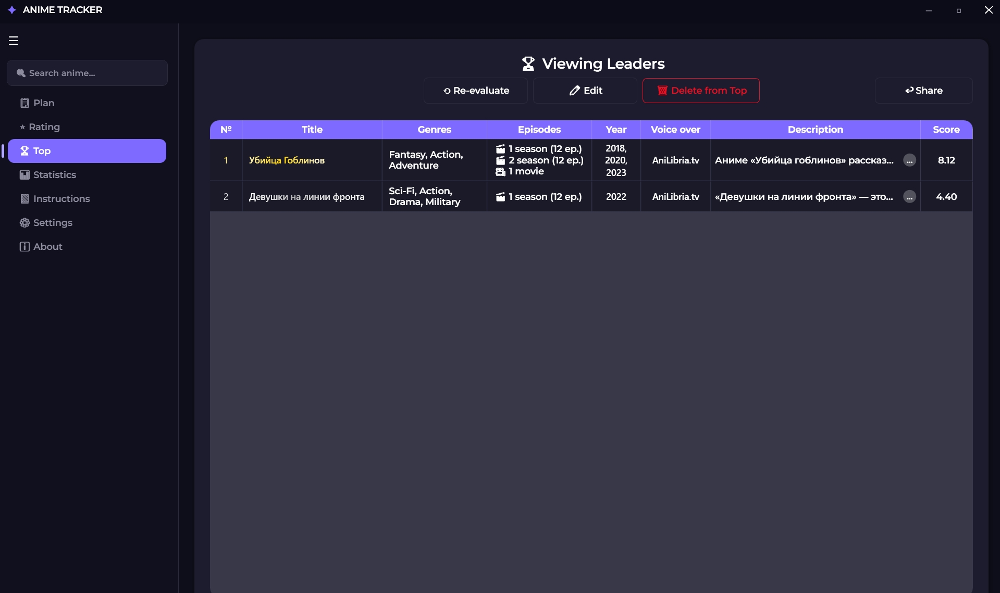
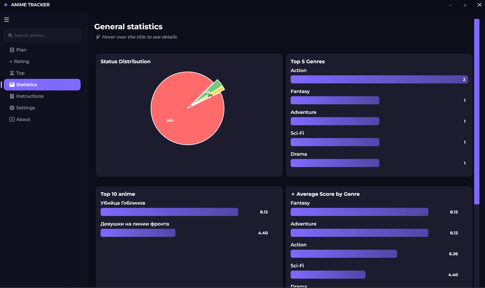
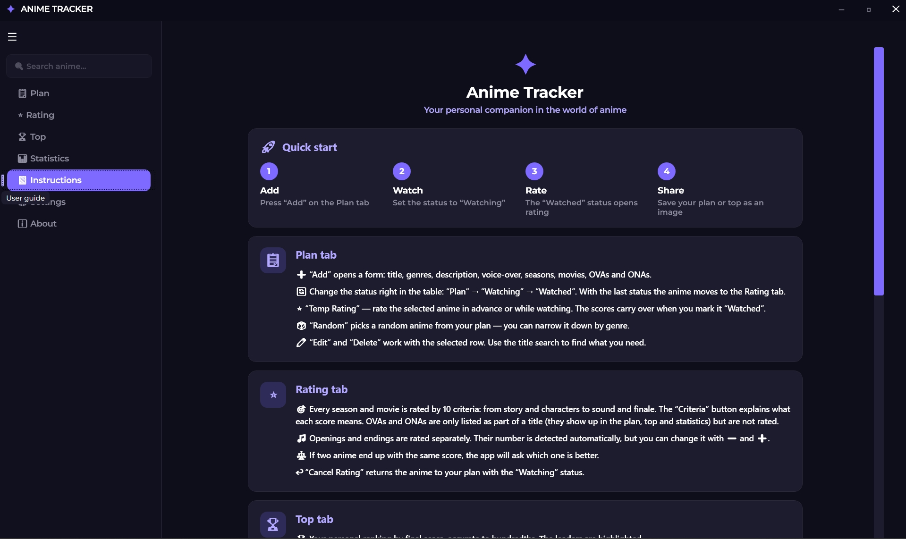
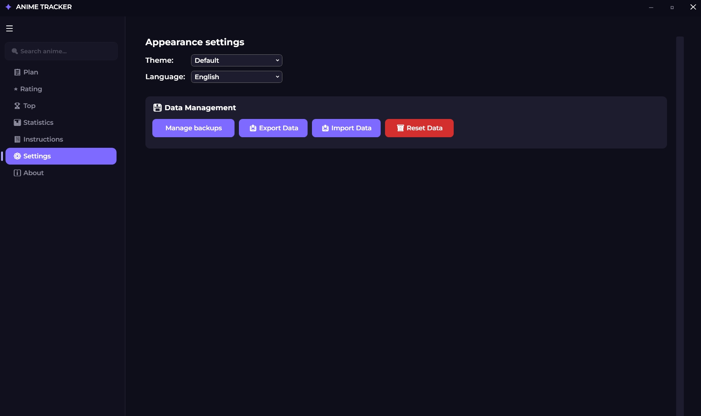
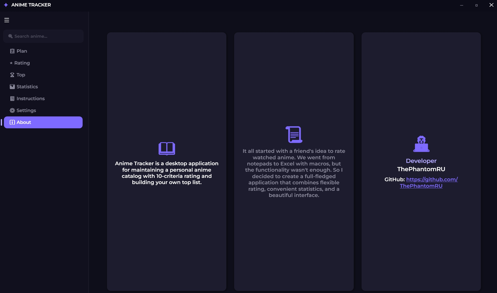

# 📋 Anime Tracker
> [🇷🇺 Читать на русском](README.ru.md)

**Anime Tracker** is a desktop WPF application for maintaining a personal anime catalog with a 10-criteria rating system and building your own top list.

## 📸 Screenshots

  

| ⭐ Rating Tab | 🏆 Top Tab |
| :---: | :---: |
|  |  |

| 📊 Statistics Tab | 📘 Instructions Tab |
| :---: | :---: |
|  |  |

| ⚙ Settings Tab | ℹ About Tab |
| :---: | :---: |
|  |  |

## ✨ Features
*   **Catalog Management:** Add anime, split into seasons, movies, and OVAs.
*   **Flexible Rating:** Rate each part using 10 criteria (from story to openings).
*   **Statistics:** Visual charts of favorite genres, top 10 anime, and dynamics by year.
*   **Customization:** 9 built-in themes and full localization (RU/EN).
*   **Data Export:** Save the anime list as a beautiful image (Share).
*   **Safety:** Automatic backups on save.

## 🛠 Tech Stack
*   **Language:** C# / .NET 10 (WPF)
*   **Architecture:** MVVM (Model-View-ViewModel)
*   **Libraries:** LiveCharts (for charts)
*   **Build:** Inno Setup + GitHub Actions (CI/CD)

## 🚀 How to Run
1. Go to the **Releases** section on the right.
2. Download the latest installer `AnimeTracker_Setup_v1.0.0.exe`.
3. Run it and enjoy!

## 👨‍💻 Author
**ThePhantomRU** — [GitHub Profile](https://github.com/ThePhantomRU)