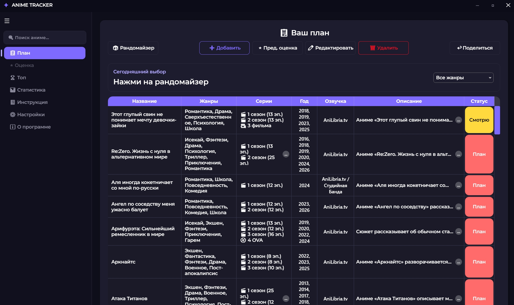
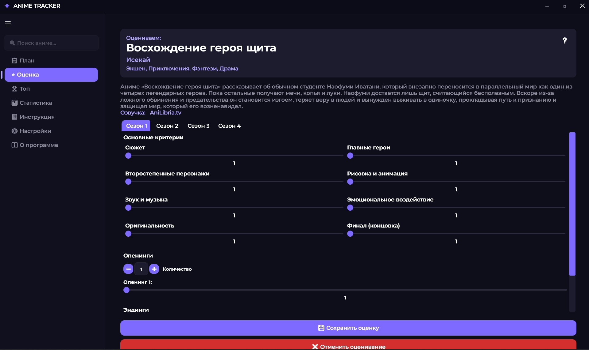
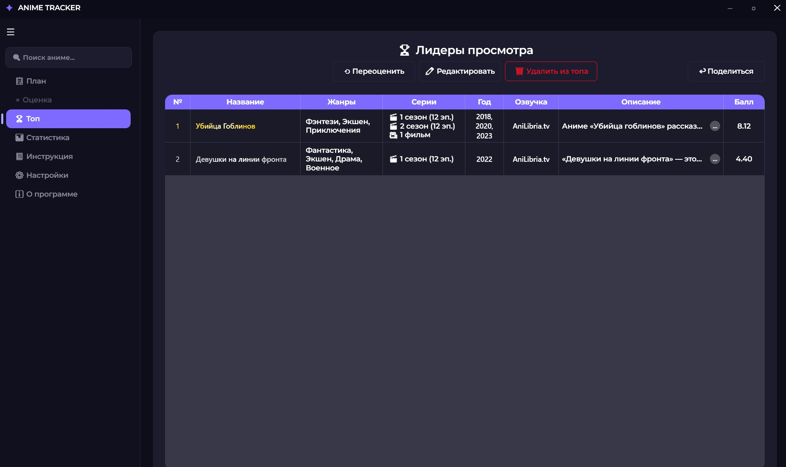
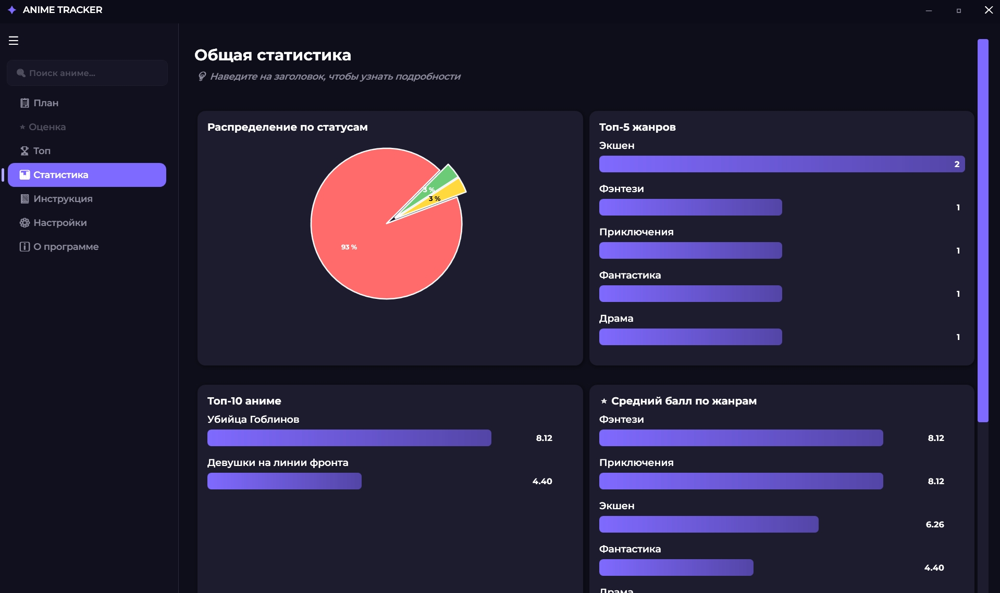
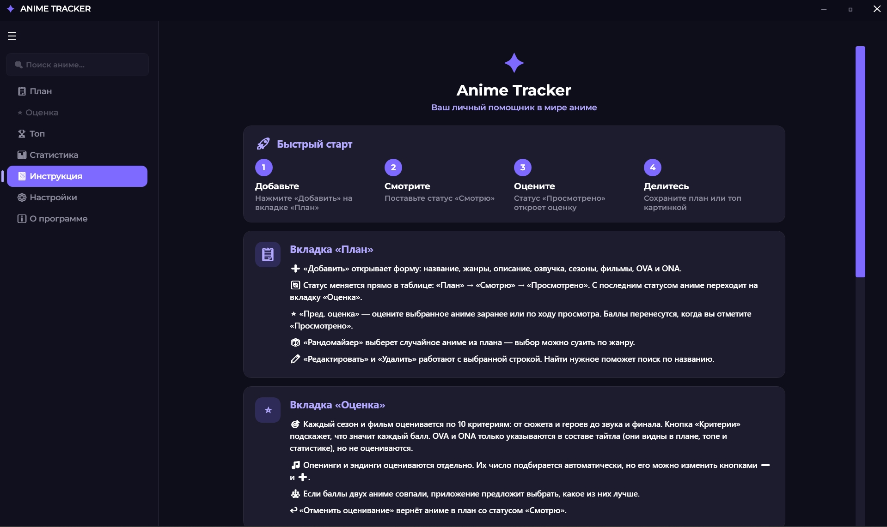
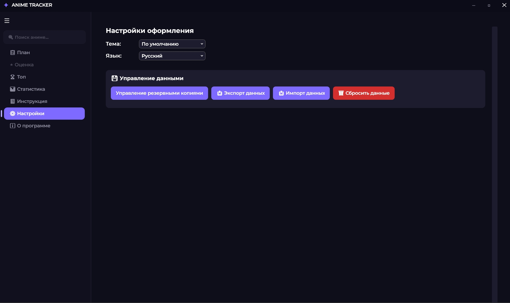
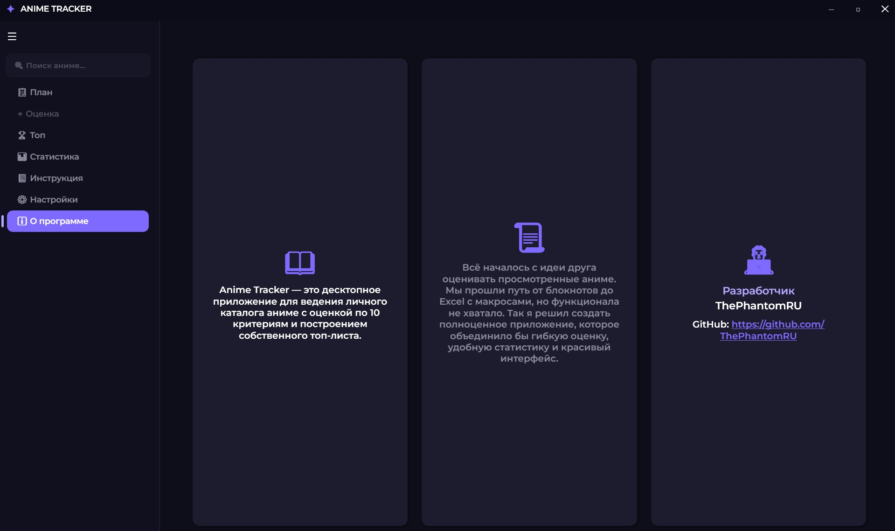

# 📋 Anime Tracker

> [🇺🇸 Read in English](README.md)

**Anime Tracker** — это десктопное WPF-приложение для ведения личного каталога аниме с оценкой по 10 критериям и построением собственного топ-листа.

## 📸 Скриншоты

  

|                       ⭐ Вкладка "Оценка"                       |                     🏆 Вкладка "Топ"                      |
| :-------------------------------------------------------------: | :-------------------------------------------------------: |
|  |  |

|                      📊 Вкладка "Статистика"                       |                          📘 Вкладка "Инструкция"                          |
| :----------------------------------------------------------------: | :-----------------------------------------------------------------------: |
|  |  |

|                        ⚙ Вкладка "Настройки"                         |                       ℹ Вкладка "О программе"                       |
| :------------------------------------------------------------------: | :-----------------------------------------------------------------: |
|  |  |

## ✨ Основные возможности

- **Управление каталогом:** Добавление аниме, разбивка по сезонам, фильмам и OVA.
- **Гибкая оценка:** Оценка каждой части по 10 критериям (от сюжета до опенингов).
- **Статистика:** Наглядные диаграммы любимых жанров, топ-10 аниме и динамика по годам.
- **Кастомизация:** 9 встроенных тем оформления и полная локализация (RU/EN).
- **Экспорт данных:** Возможность сохранить список аниме в виде красивой картинки.
- **Безопасность:** Автоматическое создание резервных копий.

## 🛠 Технологии

- **Язык:** C# / .NET 10 (WPF)
- **Архитектура:** MVVM (Model-View-ViewModel)
- **Библиотеки:** LiveCharts (для графиков)
- **Сборка:** Inno Setup + GitHub Actions (CI/CD)

## 🚀 Как запустить

1. Перейдите в раздел **Releases** справа.
2. Скачайте последний установщик `AnimeTracker_Setup_v1.0.0.exe`.
3. Запустите и наслаждайтесь!

## 👨‍💻 Автор

**ThePhantomRU** — [GitHub Profile](https://github.com/ThePhantomRU)
